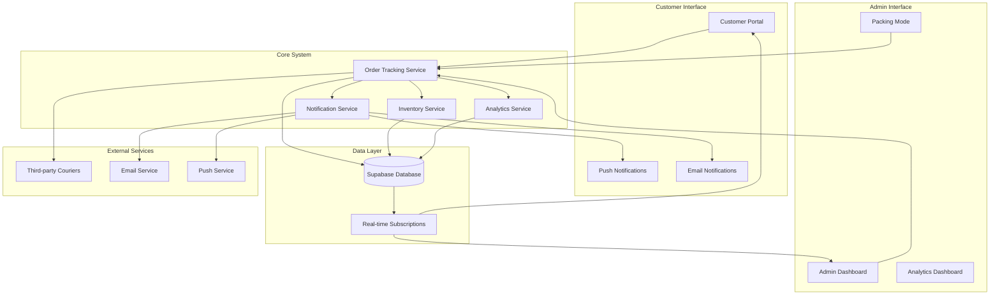

# Design Document: Enhanced Customer Order Tracking System

## Overview

The Enhanced Customer Order Tracking System builds upon the existing Next.js/Supabase infrastructure to provide comprehensive order visibility and communication for small businesses using third-party shipping services. The system focuses on cost-effective solutions that improve customer experience while maintaining operational simplicity.

The design leverages existing components and maintains the current UI theme while adding intelligent automation, real-time notifications, self-service customer options, inventory integration, and business analytics. Key principles include minimal ongoing costs, seamless integration with existing workflows, enhanced customer communication without complex third-party integrations, and comprehensive inventory management to prevent overselling.

## Architecture

### System Architecture Diagram



### Technology Stack

- **Frontend**: Next.js 14 with TypeScript (existing)
- **Backend**: Supabase with PostgreSQL (existing)
- **Real-time**: Supabase Realtime subscriptions
- **Notifications**: 
  - Email: Existing business email service
  - Push: Web Push API with service workers
- **UI Components**: Existing component library (maintaining theme)
- **State Management**: React hooks with Supabase client

## Components and Interfaces

### 1. Order Tracking Service

**Purpose**: Central service managing order status transitions and business logic

**Key Methods**:
```typescript
interface OrderTrackingService {
  updateOrderStatus(orderId: string, status: OrderStatus, metadata?: any): Promise<void>
  getOrderTimeline(orderId: string): Promise<OrderTimeline>
  calculateDeliveryEstimate(order: Order): Promise<DeliveryEstimate>
  validateStatusTransition(currentStatus: string, newStatus: string): boolean
  reserveInventory(orderItems: OrderItem[]): Promise<void>
  releaseInventory(orderItems: OrderItem[]): Promise<void>
  processCustomerRequest(orderId: string, requestType: 'cancel' | 'address_change', data: any): Promise<void>
  generateTrackingUrl(courier: string, trackingNumber: string): string
}
```

**Status Flow Management**:
- Validates status transitions (paid → in_packing → packed → shipped → delivered)
- Automatically triggers notifications on status changes
- Maintains audit trail with timestamps for all status changes
- Handles inventory reservations and releases atomically
- Processes customer self-service requests with admin approval workflow
- Generates courier-specific tracking URLs using predefined patterns

**Design Rationale**: Centralized service ensures consistent business logic application and maintains data integrity through atomic operations. The service handles both automated workflows and manual interventions seamlessly.

### 2. Enhanced Customer Portal

**Purpose**: Customer-facing interface with improved order visibility and self-service capabilities

**Key Features**:
- **Order Timeline**: Visual progress indicator with customer-friendly messaging and expected timelines
- **Delivery Estimates**: Calculated delivery dates based on courier service and location
- **Tracking Integration**: Direct links to courier tracking pages with formatted URLs
- **Real-time Updates**: Live status changes via Supabase subscriptions
- **Support Integration**: Contextual support options with order-specific context
- **Self-Service Actions**: Order cancellation requests and address change requests with status-based eligibility
- **Status Grouping**: Orders organized by current status for easy navigation
- **Push Notification Opt-in**: Device registration for real-time notifications
- **FAQ Section**: Common order-related questions and answers for self-help
- **Responsive Design**: Consistent experience across desktop, tablet, and mobile devices

**Component Structure**:
```typescript
interface CustomerOrdersPage {
  OrderList: React.Component // Accordion-style order display grouped by status
  OrderTimeline: React.Component // Visual progress indicator with friendly messaging
  TrackingInfo: React.Component // Courier tracking integration with direct links
  SupportWidget: React.Component // Contextual help options (WhatsApp, phone, email)
  SelfServiceActions: React.Component // Cancellation and address change requests
  NotificationSettings: React.Component // Push notification preferences
  FAQSection: React.Component // Common order-related questions
  DeliveryEstimator: React.Component // Estimated delivery date display
}
```

**Self-Service Request Management**:
- **Status-Based Eligibility**: Different actions available based on current order status
- **Request Validation**: Ensure requests are appropriate for order state (paid/in_packing for cancellation, unshipped for address changes)
- **Admin Notification**: Automatic alerts to administrators for pending requests
- **Outcome Communication**: Customer notifications when requests are processed
- **Request History**: Track all customer-initiated requests and their outcomes

**Design Rationale**: The enhanced portal focuses on reducing customer support burden by providing comprehensive self-service options while maintaining the existing UI theme. The accordion-style layout allows customers to quickly scan multiple orders while the timeline provides clear progress visualization. Self-service capabilities reduce support load while maintaining business control through approval workflows.

### 3. Enhanced Admin Dashboard

**Purpose**: Business-facing interface for efficient order management and analytics

**Key Enhancements**:
- **Performance Metrics**: Real-time processing time tracking and bottleneck identification
- **Inventory Alerts**: Low stock warnings and overselling prevention
- **Bulk Operations**: Multi-order status updates and batch processing
- **Analytics Integration**: Performance insights with daily/weekly/monthly summaries
- **Notification Management**: Control over customer communication and delivery tracking
- **Self-Service Request Management**: Review and approval of customer requests
- **Order Aging Indicators**: Visual indicators for orders requiring attention
- **Quick Actions**: Streamlined status updates and tracking number entry

**Component Structure**:
```typescript
interface AdminDashboard {
  OrderMetrics: React.Component // Performance indicators and processing times
  BulkActions: React.Component // Multi-order operations
  InventoryAlerts: React.Component // Stock level warnings and availability updates
  NotificationCenter: React.Component // Communication management and logs
  SelfServiceQueue: React.Component // Customer request review and approval
  OrderAgingView: React.Component // Priority indicators for delayed orders
  QuickActionPanel: React.Component // Fast status updates and tracking entry
}
```

**Design Rationale**: The admin dashboard prioritizes operational efficiency by surfacing actionable information and providing batch operations. The white/black theme consistency ensures familiarity while new analytics provide data-driven insights for business optimization.

### 4. Notification Service

**Purpose**: Multi-channel customer communication system

**Notification Channels**:
- **Email**: Order confirmations, status updates, delivery notifications
- **Push**: Real-time status changes, delivery alerts
- **Admin Alerts**: Inventory warnings, processing delays

**Service Interface**:
```typescript
interface NotificationService {
  sendOrderUpdate(orderId: string, status: string, channel: NotificationChannel[]): Promise<void>
  sendInventoryAlert(productId: string, currentStock: number): Promise<void>
  sendDeliveryNotification(orderId: string, estimatedTime: Date): Promise<void>
  registerPushSubscription(userId: string, subscription: PushSubscription): Promise<void>
}
```

### 5. Inventory Integration Service

**Purpose**: Real-time stock management with order processing

**Key Features**:
- **Atomic Reservations**: Prevent overselling during order processing
- **Automatic Updates**: Stock adjustments on order status changes
- **Low Stock Alerts**: Proactive inventory management
- **Audit Trail**: Complete inventory movement history

**Service Interface**:
```typescript
interface InventoryService {
  reserveStock(items: OrderItem[]): Promise<ReservationResult>
  confirmUsage(reservationId: string): Promise<void>
  releaseReservation(reservationId: string): Promise<void>
  checkAvailability(productId: string, quantity: number): Promise<boolean>
  getStockLevel(productId: string): Promise<StockInfo>
}
```

### 6. Analytics Service

**Purpose**: Business intelligence and performance monitoring

**Key Metrics**:
- **Processing Times**: Average time per order stage with bottleneck identification
- **Bottleneck Identification**: Stages causing delays with actionable insights
- **Customer Satisfaction**: Delivery performance tracking and satisfaction ratings
- **Inventory Turnover**: Stock movement analysis and optimization recommendations
- **Order Aging Analysis**: Track orders requiring attention based on processing delays
- **Performance Alerts**: Automatic notifications when processing times exceed thresholds

**Service Interface**:
```typescript
interface AnalyticsService {
  getProcessingMetrics(dateRange: DateRange): Promise<ProcessingMetrics>
  identifyBottlenecks(): Promise<BottleneckAnalysis>
  getCustomerSatisfactionScore(): Promise<SatisfactionMetrics>
  generatePerformanceReport(period: ReportPeriod): Promise<PerformanceReport>
  trackOrderAging(): Promise<AgingAnalysis>
  generateDailyWeeklyMonthlySummary(period: 'daily' | 'weekly' | 'monthly'): Promise<PerformanceSummary>
}
```

### 7. Self-Service Management Service

**Purpose**: Handle customer-initiated requests and approvals

**Key Features**:
- **Request Validation**: Ensure requests are valid based on current order status
- **Admin Notification**: Alert administrators of pending requests
- **Status-Based Permissions**: Different actions available based on order status
- **Approval Workflow**: Structured process for request review and approval

**Service Interface**:
```typescript
interface SelfServiceService {
  submitCancellationRequest(orderId: string, reason: string): Promise<RequestResult>
  submitAddressChangeRequest(orderId: string, newAddress: Address): Promise<RequestResult>
  getAvailableActions(orderId: string): Promise<SelfServiceAction[]>
  processAdminApproval(requestId: string, approved: boolean, notes?: string): Promise<void>
  getPendingRequests(): Promise<SelfServiceRequest[]>
}
```

**Design Rationale**: Self-service capabilities reduce support burden while maintaining business control through approval workflows. Status-based permissions ensure customers can only request appropriate actions.

### 8. Courier Integration Service

**Purpose**: Manage third-party courier integrations and tracking

**Supported Couriers**:
- **DTDC**: Direct tracking page integration
- **Blue Dart**: Formatted tracking URLs
- **Extensible Framework**: Easy addition of new courier services

**Service Interface**:
```typescript
interface CourierService {
  generateTrackingUrl(courier: CourierType, trackingNumber: string): string
  validateTrackingNumber(courier: CourierType, trackingNumber: string): boolean
  getDeliveryTimeframe(courier: CourierType, destination: string): Promise<DeliveryEstimate>
  getSupportedCouriers(): CourierType[]
}

type CourierType = 'dtdc' | 'bluedart' | 'delhivery' | 'ecom' | 'custom'
```

**URL Pattern Configuration**:
```typescript
const COURIER_PATTERNS = {
  dtdc: 'https://www.dtdc.in/tracking/tracking_results.asp?strCnno={trackingNumber}',
  bluedart: 'https://www.bluedart.com/web/guest/trackdartresult?trackFor=0&trackNo={trackingNumber}',
  delhivery: 'https://www.delhivery.com/track/package/{trackingNumber}',
  // Extensible for additional couriers
}
```

**Design Rationale**: Cost-effective approach using direct tracking page redirects instead of paid API integrations. Pattern-based URL generation allows easy addition of new courier services without code changes.

## Data Models

### Enhanced Order Model

```typescript
interface Order {
  // Existing fields
  id: string
  customer_name: string
  customer_email: string
  customer_phone: string
  status: OrderStatus
  total_amount: number
  created_at: string
  updated_at: string
  
  // Enhanced tracking fields
  packing_started_at?: string
  packed_at?: string
  shipped_at?: string
  delivered_at?: string
  cancelled_at?: string
  
  // Shipping information
  shipping_company?: string
  tracking_id?: string
  estimated_delivery?: string
  actual_delivery?: string
  
  // Customer communication
  notification_preferences: NotificationPreferences
  last_notification_sent?: string
  push_subscription?: PushSubscription
  
  // Business analytics
  processing_time_minutes?: number
  customer_satisfaction_rating?: number
  
  // Self-service tracking
  pending_requests?: SelfServiceRequest[]
}

type OrderStatus = 'paid' | 'in_packing' | 'packed' | 'shipped' | 'delivered' | 'cancelled'

interface NotificationPreferences {
  email: boolean
  push: boolean
  sms: boolean
  timing_preference: 'immediate' | 'daily_digest' | 'milestone_only'
}
```

### Self-Service Request Model

```typescript
interface SelfServiceRequest {
  id: string
  order_id: string
  request_type: 'cancellation' | 'address_change'
  status: 'pending' | 'approved' | 'rejected'
  customer_reason?: string
  admin_notes?: string
  requested_at: string
  processed_at?: string
  processed_by?: string
  
  // Request-specific data
  cancellation_data?: {
    reason: string
    refund_requested: boolean
  }
  
  address_change_data?: {
    old_address: Address
    new_address: Address
    change_reason: string
  }
}
```

### Inventory Reservation Model

```typescript
interface InventoryReservation {
  id: string
  order_id: string
  product_id: string
  quantity_reserved: number
  reserved_at: string
  expires_at: string
  status: 'active' | 'confirmed' | 'released' | 'expired'
  created_by: string
  
  // Enhanced tracking
  confirmation_method: 'auto' | 'manual' | 'packing_scan'
  release_reason?: 'cancellation' | 'expiry' | 'insufficient_stock' | 'manual'
}
```

### Notification Log Model

```typescript
interface NotificationLog {
  id: string
  order_id: string
  notification_type: 'email' | 'push' | 'sms'
  status: 'sent' | 'delivered' | 'failed' | 'bounced'
  sent_at: string
  delivered_at?: string
  failed_at?: string
  content_template: string
  recipient: string
  
  // Enhanced tracking
  engagement_data?: {
    opened_at?: string
    clicked_at?: string
    tracking_url_clicked?: boolean
  }
  
  retry_count: number
  error_message?: string
}
```

### Analytics Metrics Model

```typescript
interface OrderMetrics {
  id: string
  order_id: string
  metric_type: 'processing_time' | 'customer_satisfaction' | 'delivery_accuracy' | 'self_service_usage'
  metric_value: number
  recorded_at: string
  metadata: Record<string, any>
  
  // Enhanced analytics
  stage_breakdown?: {
    paid_to_packing: number
    packing_to_packed: number
    packed_to_shipped: number
    shipped_to_delivered: number
  }
}

interface PerformanceSummary {
  period: 'daily' | 'weekly' | 'monthly'
  date_range: { start: string; end: string }
  total_orders: number
  average_processing_time: number
  bottlenecks: BottleneckInfo[]
  customer_satisfaction_score: number
  self_service_usage_rate: number
  inventory_turnover_rate: number
}
```

## UI/UX Design Guidelines

### Design Consistency Requirements

**Customer Portal Design**:
- **Theme Preservation**: Maintain existing color scheme, typography, and component styling
- **Responsive Design**: Ensure all new features work consistently across desktop, tablet, and mobile
- **Navigation Patterns**: Preserve existing user workflows and menu structures
- **Component Reuse**: Utilize existing component library (buttons, cards, forms, modals)
- **Loading States**: Consistent loading indicators and skeleton screens
- **Workflow Preservation**: Ensure new features don't disrupt existing user journeys

**Admin Dashboard Design**:
- **White/Black Theme**: Maintain existing admin interface color scheme
- **Layout Patterns**: Preserve current sidebar navigation and content area structure
- **Table Consistency**: Use existing table components and styling patterns
- **Action Buttons**: Maintain current button styles and interaction patterns
- **Modal Dialogs**: Consistent modal design for confirmations and forms
- **Navigation Continuity**: Preserve existing admin workflows and menu structures

**Design Tokens and Components**:
```typescript
// Reuse existing design system
import { Button, Card, Modal, Table, Badge } from '@/shared/ui'
import { useTheme } from '@/shared/contexts/ThemeContext'

// Maintain existing color palette
const THEME_COLORS = {
  customer: {
    primary: 'existing-primary-color',
    secondary: 'existing-secondary-color',
    success: 'existing-success-color',
    warning: 'existing-warning-color'
  },
  admin: {
    background: 'white',
    text: 'black',
    accent: 'existing-admin-accent'
  }
}
```

**Design Rationale**: Consistency reduces development time, maintains user familiarity, and ensures a cohesive experience. Reusing existing components minimizes testing overhead and maintains design system integrity.

## Cost-Effective Implementation Strategy

### Infrastructure Decisions

**Database Strategy**:
- **Existing Supabase**: Leverage current PostgreSQL database without additional services
- **Real-time Features**: Use Supabase's built-in real-time subscriptions (included in current plan)
- **Storage**: Utilize existing Supabase storage for any additional assets
- **Backup Strategy**: Rely on Supabase's automated backup system

**Notification Strategy**:
- **Email Service**: Use business's existing email service (no additional cost)
- **Push Notifications**: Implement Web Push API (free browser-based notifications)
- **SMS Avoidance**: Focus on email and push to avoid SMS costs
- **Template Management**: Store email templates in database rather than external services

**Third-Party Integration Strategy**:
- **Courier Tracking**: Use direct URL redirects instead of paid API integrations
- **No Premium APIs**: Avoid courier APIs that charge per request
- **Pattern-Based URLs**: Maintain courier URL patterns in configuration
- **Graceful Degradation**: Handle unavailable courier services without system failure

**Hosting and Deployment**:
- **Existing Next.js Infrastructure**: Build on current Vercel/hosting setup
- **No Additional Services**: Avoid new cloud services or databases
- **Static Asset Optimization**: Use existing CDN and image optimization
- **Serverless Functions**: Leverage existing serverless capabilities for background tasks

### Development Efficiency Decisions

**Code Reuse Strategy**:
- **Component Library**: Extend existing UI components rather than creating new ones
- **Service Layer**: Build on existing backend service patterns
- **Authentication**: Use existing auth system without modifications
- **State Management**: Extend current React state patterns

**Testing Strategy**:
- **Existing Test Framework**: Use current testing setup (Jest, React Testing Library)
- **Property-Based Testing**: Add fast-check library (minimal cost addition)
- **CI/CD Integration**: Leverage existing deployment pipeline
- **Manual Testing**: Focus on critical paths to minimize automated test overhead

**Monitoring and Analytics**:
- **Built-in Logging**: Use existing application logging
- **Database Analytics**: Query existing data for insights
- **Performance Monitoring**: Leverage existing monitoring tools
- **User Feedback**: Implement simple feedback collection without external services

**Design Rationale**: This strategy minimizes ongoing operational costs while maximizing feature value. By building on existing infrastructure and avoiding premium services, the system remains cost-effective for small businesses while providing enterprise-level functionality.

## Correctness Properties

*A property is a characteristic or behavior that should hold true across all valid executions of a system—essentially, a formal statement about what the system should do. Properties serve as the bridge between human-readable specifications and machine-verifiable correctness guarantees.*

Based on the requirements analysis, here are the key correctness properties that must be validated through property-based testing:

### Property 1: Customer-Friendly Status Display Consistency
*For any* order status change, the customer-facing display should use friendly language, include expected timelines, and show clear next steps with consistent terminology throughout the interface.
**Validates: Requirements 1.1, 1.2, 1.3, 5.5**

### Property 2: Status History Preservation and Audit Trail
*For any* order status update, all historical status information should be preserved with proper timestamps for audit purposes, maintaining complete traceability.
**Validates: Requirements 1.5, 8.1**

### Property 3: Tracking Information Completeness and Integration
*For any* shipped order, the system should store tracking numbers, provide direct courier links, and display courier service names with delivery timeframes prominently.
**Validates: Requirements 2.1, 2.2, 2.3, 5.3**

### Property 4: Courier Link Format Validation
*For any* supported courier service and tracking number combination, tracking links should be formatted correctly according to that courier's URL pattern.
**Validates: Requirements 2.5**

### Property 5: Comprehensive Notification Delivery and Logging
*For any* major order milestone, appropriate notifications (email and/or push) should be sent with customer-friendly language, order-specific information, next steps, and proper logging.
**Validates: Requirements 3.1, 3.2, 3.3, 3.5, 10.2, 10.3, 10.5**

### Property 6: Support Context Integration and Accessibility
*For any* customer order view or support interaction, the system should provide prominent support options with order-specific context across multiple channels (WhatsApp, phone, email) and include FAQ sections for self-help.
**Validates: Requirements 4.1, 4.2, 4.3, 4.4, 4.5**

### Property 7: Self-Service Request Management
*For any* customer self-service request (cancellation or address change), the system should validate eligibility based on order status, notify administrators, and provide outcome notifications.
**Validates: Requirements 9.1, 9.2, 9.3, 9.4, 9.5**

### Property 8: Push Notification Registration and Preference Management
*For any* customer opt-in action, the system should properly register their device for push notifications, respect their preferences and timing, and track delivery status.
**Validates: Requirements 10.1, 10.4, 10.5**

### Property 9: Inventory Reservation Lifecycle Management
*For any* order lifecycle (place → pack → cancel), inventory should be properly reserved, confirmed, or released maintaining accurate stock levels and preventing overselling.
**Validates: Requirements 12.1, 12.2, 12.3, 12.4**

### Property 10: Visual Timeline and Delivery Estimation
*For any* order, the customer portal should display a visual timeline showing progress with estimated delivery dates based on courier service timelines and status grouping.
**Validates: Requirements 5.1, 5.2, 5.4**

### Property 11: Responsive Design Consistency
*For any* new UI feature across customer and admin interfaces, responsive design should work consistently across all devices while maintaining existing theme and navigation patterns.
**Validates: Requirements 13.4**

### Property 12: Low Stock Alert System
*For any* inventory level change that results in low stock conditions, the system should alert administrators and update product availability status in real-time.
**Validates: Requirements 12.5**

## Error Handling

### Order Status Transition Errors
- **Invalid Transitions**: Prevent status changes that violate business rules (e.g., shipped → in_packing)
- **Concurrent Updates**: Handle simultaneous status updates using database transactions
- **Missing Data**: Validate required fields before status transitions (e.g., tracking number for shipped status)

### Notification Failures
- **Email Delivery**: Retry failed email notifications with exponential backoff
- **Push Notification**: Handle device registration failures and expired subscriptions
- **Fallback Communication**: Use alternative channels when primary notification fails

### Inventory Conflicts
- **Overselling Prevention**: Use atomic database operations for inventory reservations
- **Reservation Expiry**: Automatically release expired inventory reservations
- **Stock Reconciliation**: Periodic inventory audits to detect and correct discrepancies

### Third-Party Integration Errors
- **Courier API Failures**: Graceful degradation when courier tracking services are unavailable
- **Invalid Tracking Numbers**: Validate tracking number formats before storage
- **Service Timeouts**: Handle slow or unresponsive external services

### Data Consistency Errors
- **Database Constraints**: Enforce referential integrity between orders, customers, and inventory
- **Audit Trail Gaps**: Ensure all order changes are logged even during system failures
- **Real-time Sync**: Handle Supabase subscription connection failures

## Testing Strategy

### Dual Testing Approach

The system requires both unit testing and property-based testing for comprehensive coverage:

**Unit Tests** focus on:
- Specific business logic examples
- Edge cases and error conditions  
- Integration points between components
- UI component behavior with specific data

**Property Tests** focus on:
- Universal properties across all inputs
- Comprehensive input coverage through randomization
- System behavior under various conditions
- Data integrity and consistency

### Property-Based Testing Configuration

- **Testing Library**: fast-check for TypeScript/JavaScript property-based testing
- **Test Iterations**: Minimum 100 iterations per property test
- **Test Tagging**: Each property test tagged with format: **Feature: enhanced-order-tracking, Property {number}: {property_text}**

### Key Testing Areas

**Order Status Management**:
- Unit tests for specific status transition scenarios
- Property tests for status display consistency across all orders
- Integration tests for status change notifications

**Notification System**:
- Unit tests for specific notification templates
- Property tests for notification delivery across all order types
- Integration tests for multi-channel notification coordination

**Inventory Management**:
- Unit tests for specific reservation scenarios
- Property tests for inventory consistency across all operations
- Integration tests for order-inventory synchronization

**Customer Experience**:
- Unit tests for specific UI components
- Property tests for display consistency across all order states
- End-to-end tests for complete customer journeys

**Analytics and Reporting**:
- Unit tests for specific metric calculations
- Property tests for data accuracy across all time periods
- Performance tests for report generation under load

### Test Data Management

- **Synthetic Data**: Generate realistic test orders, customers, and inventory
- **Edge Cases**: Test with boundary conditions (zero inventory, expired orders, etc.)
- **Performance Data**: Test with large datasets to validate scalability
- **Error Scenarios**: Test system behavior under various failure conditions

This comprehensive testing strategy ensures the enhanced order tracking system maintains reliability while providing improved customer experience and business insights.