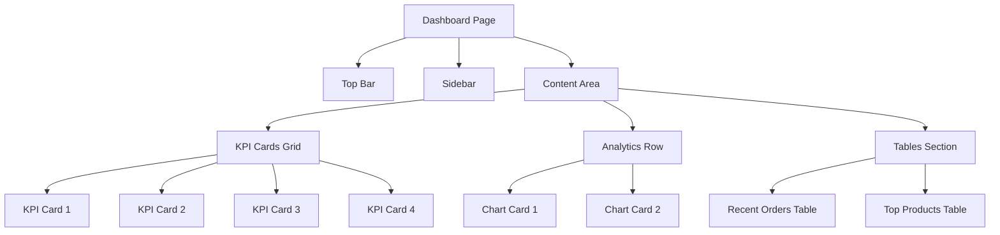
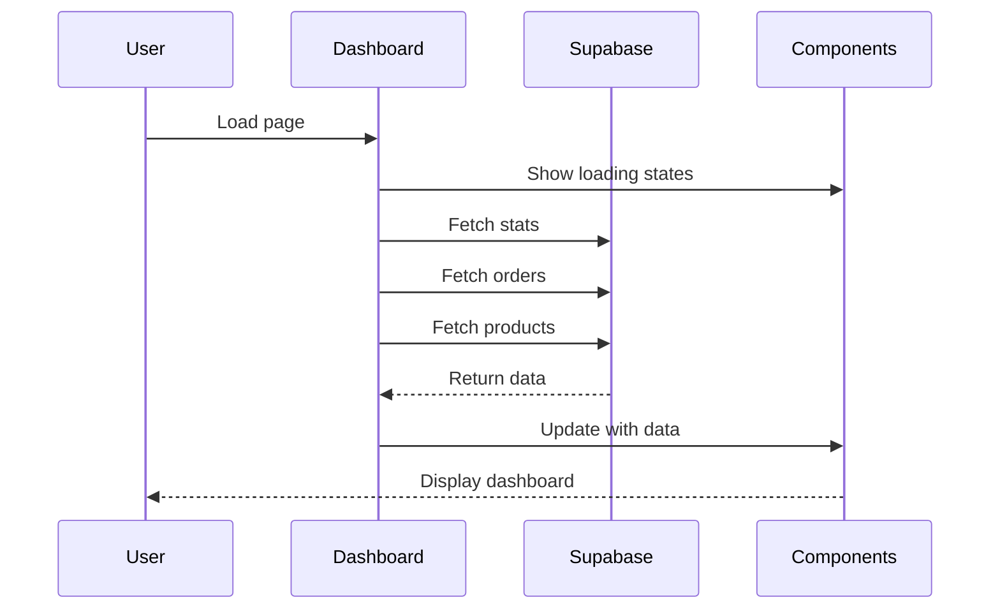
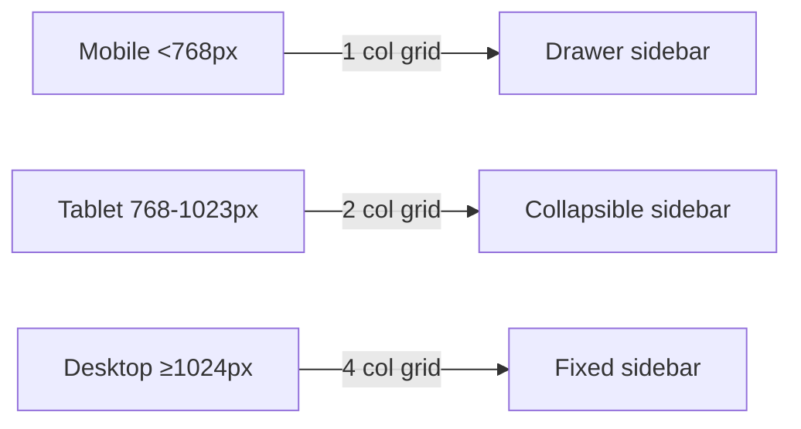

# Modern Dashboard Redesign - Design Document

## Overview

This design document specifies the complete redesign of the Kalamkari e-commerce admin dashboard. The redesign transforms the existing dashboard into a modern, information-dense interface that prioritizes clarity, scannability, and speed of comprehension. The design follows a strict implementation contract with non-negotiable constraints on spacing, height, and visual hierarchy.

### Design Philosophy

- **Information Density**: Maximize useful information within viewport constraints
- **Visual Hierarchy**: KPI cards are the primary focus; all other components are visually subordinate
- **Purposeful Space**: Empty space communicates grouping, not decoration
- **Consistency**: All card components inherit styling from KPI card design
- **Defaults**: When unclear, choose smaller, flatter, denser

### Technology Stack

- **Framework**: Next.js 14+ with App Router
- **Styling**: Tailwind CSS
- **UI Components**: shadcn/ui (where applicable)
- **Charts**: Recharts library
- **Backend**: Supabase (existing integration)
- **Language**: TypeScript

---

## Architecture

### App Shell Structure

The dashboard uses a fixed app-shell layout with three primary regions:

```
┌─────────────────────────────────────────────────────┐
│                    Top Bar (72px)                    │
├──────────┬──────────────────────────────────────────┤
│          │                                           │
│ Sidebar  │         Content Area                      │
│ (260px)  │         (max-width: 1440px)              │
│          │                                           │
│  Fixed   │         Scrollable                        │
│          │                                           │
└──────────┴──────────────────────────────────────────┘
```

### Layout Regions

1. **Top Bar**
   - Height: 72px (fixed)
   - Position: Sticky
   - Contains: Logo, search, notifications, user menu, dark mode toggle
   - Z-index: 50

2. **Sidebar**
   - Width: 260px (desktop), 220px (tablet), drawer (mobile)
   - Position: Fixed (desktop/tablet), overlay drawer (mobile)
   - Contains: Navigation menu, user profile
   - Collapsible on tablet, drawer on mobile

3. **Content Area**
   - Max-width: 1440px
   - Padding: 24px (desktop), 20px (tablet), 16px (mobile)
   - Margin: 0 auto (centered)
   - Background: gray-50 (light mode), gray-900 (dark mode)

### Viewport Budget (1440px screens)

**Critical Constraint**: Above-the-fold contains ONLY:

1. **Top Bar**: 72px
2. **Header Spacing**: 24px (below top bar)
3. **KPI Cards Row**: 140px (max card height) + 20px (gap) = 160px
4. **Section Spacing**: 32px
5. **ONE Analytics Row**: 320px (max chart height)

**Total**: 72 + 24 + 160 + 32 + 320 = 608px

This ensures all KPI cards and one analytics row fit within a typical 1440px screen viewport (≈900px height after browser chrome).

### Analytics Row Constraints (Critical)

**Maximum Content**:
- Maximum 2 chart cards per analytics row
- No third chart allowed in above-the-fold area
- Charts must use equal-width grid columns (1fr units)

**Chart Card Internal Constraints**:
- Legends must wrap inside card, never increase card height
- Header + chart + legend must fit within 320px total height
- If legend doesn't fit, use tooltip-based legend instead
- Truncate legend labels with ellipsis if needed

**Grid Layout**:
```css
grid-template-columns: repeat(2, 1fr);
gap: 20px;
```

---

## Components and Interfaces

### 1. KPI Card Component

The KPI card defines the visual language for all card components in the dashboard.

#### Specifications

**Dimensions**:
- Max height: 140px (strict constraint)
- Width: 100% of grid column (equal-width columns)
- Padding: 20px (all sides)
- Border radius: 14px
- Gap between cards: 20px

**Visual Elements**:
```
┌─────────────────────────────────────────┐
│  [Icon 36px]              [Delta Badge] │  ← Top section
│                                         │
│  LABEL (14px, gray-500)                │  ← Middle section
│  Value (24px, bold)                    │
│  comparison text (12px)                │
│                                         │
│  ─────────────────────────────          │  ← Bottom section
│  Sparkline (40px height, 0.6 opacity)  │
└─────────────────────────────────────────┘
```

**Icon Container**:
- Size: 36px × 36px
- Background: accent-light (varies by card theme)
- Border radius: 10px
- Padding: 8px (icon is 20px actual size)

**Label**:
- Font size: 14px
- Color: gray-500 (light mode), gray-400 (dark mode)
- Font weight: 600 (semibold)
- Text transform: uppercase
- Letter spacing: 0.05em

**Primary Value**:
- Font size: 24px
- Font weight: 700 (bold)
- Color: gray-900 (light mode), white (dark mode)
- Line height: 1.2

**Delta Badge**:
- Position: Top right
- Padding: 4px 8px
- Border radius: 6px
- Font size: 12px
- Font weight: 700
- Icon: 14px (TrendingUp/TrendingDown/Minus)
- Colors:
  - Positive: green-600 text, green-50 background
  - Negative: red-600 text, red-50 background
  - Neutral: gray-600 text, gray-100 background

**Sparkline**:
- Height: 40px
- Opacity: 0.6
- Type: Area chart
- Stroke width: 2px
- Gradient fill: from accent color (0.6 opacity) to transparent
- Animation: 1500ms ease-in-out
- Data points: 30 (for smooth curves)

**Card Backgrounds**:
- Solid: white (light mode), gray-800 (dark mode)
- Gradient: subtle linear gradient (135deg)
- Shadow: soft elevation (0 1px 3px rgba(0,0,0,0.1))
- Hover: increased elevation (0 4px 6px rgba(0,0,0,0.1))

**Grid Layout**:
- Desktop (≥1024px): 4 columns
- Tablet (768px-1023px): 2 columns
- Mobile (<768px): 1 column
- Grid template: `repeat(auto-fit, minmax(0, 1fr))`
- Gap: 20px

#### TypeScript Interface

```typescript
interface KPICardProps {
  title: string;
  value: string | number;
  icon: React.ReactNode;
  trend?: {
    value: number;
    direction: "up" | "down" | "neutral";
  };
  sparklineData?: Array<{ value: number }>;
  gradient?: {
    from: string;
    to: string;
  };
  onClick?: () => void;
  comparison?: string;
  borderColor?: string;
  shadowColor?: string;
  theme?: "light" | "dark";
}
```

### 2. Chart Card Component

Chart cards follow the KPI card visual language but with specific adaptations for data visualization.

#### Specifications

**Dimensions**:
- Max height: 320px (strict constraint)
- Width: 100% of grid column
- Padding: 20px (inherited from KPI cards)
- Border radius: 14px (inherited from KPI cards)
- Shadow: soft-elevated (inherited from KPI cards)

**Visual Hierarchy**:
- Charts must be visually subordinate to KPI cards
- Use softer colors (reduced saturation)
- Lighter borders
- Reduced visual weight

**Chart Types**:

1. **Donut Chart** (Sales Source):
   - Center label with primary metric
   - Legend on right side
   - Colors: primary, secondary, warning, info
   - Stroke width: 12px
   - Inner radius: 60%
   - Outer radius: 80%

2. **Line Chart** (Statistics):
   - Maximum 2 lines
   - Smooth curves (monotone interpolation)
   - Grid lines: subtle (gray-200 light, gray-700 dark)
   - Stroke width: 2px
   - Dot size: 4px (on hover)
   - Tooltip: on hover with relevant data

**Chart Colors** (Muted for subordination):
- Primary: green-500 (light mode), green-400 (dark mode)
- Secondary: blue-500 (light mode), blue-400 (dark mode)
- Warning: yellow-500 (light mode), yellow-400 (dark mode)
- Info: cyan-500 (light mode), cyan-400 (dark mode)

**Header Section**:
- Title: 16px, semibold, gray-900 (light), white (dark)
- Icon: 20px, in colored circle (32px)
- Actions: Button or dropdown on right

#### TypeScript Interface

```typescript
interface ChartCardProps {
  title: string;
  icon: React.ReactNode;
  chartType: "donut" | "line" | "bar";
  data: any[];
  height?: number; // max 320px
  actions?: React.ReactNode;
  legend?: boolean;
  gridLines?: boolean;
}
```

### 3. Data Table Component

Tables follow the card styling and maintain readability through proper spacing.

#### Specifications

**Container**:
- Padding: 20px (inherited from KPI cards)
- Border radius: 14px (inherited from KPI cards)
- Background: white (light), gray-800 (dark)
- Shadow: soft-elevated (inherited from KPI cards)

**Table Structure**:
- Row height: 56px (comfortable scanning)
- Cell padding: 12px
- Header: sticky during scroll
- Header background: gray-50 (light), gray-700 (dark)
- Header text: 14px (max, never exceed KPI label size), uppercase, semibold, gray-600
- Borders: gray-200 (light), gray-700 (dark) only
- Shadow: base (0 1px 3px rgba(0,0,0,0.1)) - never stronger than KPI cards
- Position: Must appear after first scroll, not in above-the-fold area

**Row States**:
- Default: transparent background
- Hover: gray-50 (light), gray-700 (dark)
- Active: gray-100 (light), gray-600 (dark)

**Status Badges**:
- Padding: 4px 12px
- Border radius: 12px (pill shape)
- Font size: 12px
- Font weight: 600
- Colors:
  - Success (delivered): green-600 text, green-50 bg
  - Info (shipped): blue-600 text, blue-50 bg
  - Warning (pending): yellow-600 text, yellow-50 bg
  - Danger (cancelled): red-600 text, red-50 bg

**Responsive Behavior**:
- Desktop: Full table
- Tablet: Horizontal scroll if needed
- Mobile: Card-based layout or horizontal scroll

#### TypeScript Interface

```typescript
interface TableColumn<T> {
  key: keyof T;
  label: string;
  sortable?: boolean;
  align?: "left" | "center" | "right";
  render?: (item: T) => React.ReactNode;
}

interface DataTableProps<T> {
  title: string;
  icon: React.ReactNode;
  columns: TableColumn<T>[];
  data: T[];
  onRowClick?: (item: T) => void;
  actions?: React.ReactNode;
  emptyState?: {
    icon: React.ReactNode;
    message: string;
  };
}
```

### 4. Top Bar Component

#### Specifications

**Dimensions**:
- Height: 72px (fixed)
- Padding: 0 24px
- Position: sticky, top: 0
- Z-index: 50

**Visual Weight Rules** (Critical):
- Must remain visually neutral
- No gradients, accent colors, or elevation beyond base shadow
- No element may exceed KPI label visual weight
- Search input must collapse to icon-only at ≤1280px
- Notification badges must be subtle (gray scale only)

**Layout**:
```
┌────────────────────────────────────────────────────┐
│ [Logo]  [Search/Icon]   [Notifications] [User] [⚙] │
└────────────────────────────────────────────────────┘
```

**Elements**:
- Logo: 32px height
- Search: 320px width at >1280px, icon-only (40px) at ≤1280px, 40px height
- Icons: 20px size, 40px touch target
- User avatar: 36px circle
- Gap between elements: 16px
- Notification badges: gray scale only (no accent colors)

**Colors**:
- Background: white (light), gray-800 (dark)
- Border bottom: gray-200 (light), gray-700 (dark)
- Text: gray-900 (light), white (dark)
- Shadow: base only (0 1px 3px rgba(0,0,0,0.1))

### 5. Sidebar Component

#### Specifications

**Dimensions**:
- Width: 260px (desktop), 220px (tablet)
- Height: 100vh
- Position: fixed (desktop/tablet), drawer (mobile)
- Padding: 24px 16px

**Navigation Items**:
- Height: 44px (minimum touch target)
- Padding: 12px 16px
- Border radius: 8px
- Gap: 4px between items

**States**:
- Default: transparent
- Hover: gray-100 (light), gray-700 (dark)
- Active: primary-50 (light), primary-900 (dark)
- Active text: primary-600 (light), primary-400 (dark)

**Icon + Label**:
- Icon: 20px
- Label: 14px, medium weight
- Gap: 12px

---

## Data Models

### Dashboard Data Structure

```typescript
interface DashboardData {
  stats: EnhancedStats;
  recentOrders: OrderPreview[];
  topProducts: TopProduct[];
  productCount: number;
}

interface EnhancedStats extends OrderStats {
  revenue_growth: number;
  orders_growth: number;
  avg_order_value: number;
  completion_rate: number;
  processing_time_avg: number;
  monthly_revenue: number;
  weekly_orders: number;
}

interface OrderPreview {
  id: string;
  customer_name: string | null;
  total_amount: number;
  status: string;
  created_at: string;
}

interface TopProduct {
  id: string;
  name: string;
  image: string;
  total_sold: number;
  revenue: number;
}

interface SparklineData {
  revenue: Array<{ value: number }>;
  orders: Array<{ value: number }>;
  inventory: Array<{ value: number }>;
  shipping: Array<{ value: number }>;
}
```

### Data Fetching Strategy

1. **Initial Load**: Fetch all dashboard data in parallel
2. **Loading States**: Show skeleton loaders for each component
3. **Error Handling**: Display error states with retry options
4. **Caching**: Use React Query or SWR for data caching
5. **Refresh**: Auto-refresh every 5 minutes or manual refresh

---

## Design System

### Color Palette

#### Light Mode

**Grays** (Structural):
- gray-50: #F8FAFC (background)
- gray-100: #F1F5F9 (hover states)
- gray-200: #E2E8F0 (borders)
- gray-300: #CBD5E1 (disabled)
- gray-400: #94A3B8 (secondary text)
- gray-500: #64748B (labels)
- gray-600: #475569 (primary text)
- gray-700: #334155 (headings)
- gray-800: #1E293B (emphasis)
- gray-900: #0F172A (maximum contrast)

**Primary** (Green - Main actions, positive states):
- primary-50: #F0FDF4
- primary-100: #DCFCE7
- primary-500: #16A34A
- primary-600: #15803D
- primary-900: #14532D

**Secondary** (Blue - Secondary actions):
- secondary-50: #EFF6FF
- secondary-100: #DBEAFE
- secondary-500: #2563EB
- secondary-600: #1D4ED8

**Accent Colors** (State indicators):
- Success: #22C55E (green-500)
- Warning: #F59E0B (yellow-500)
- Danger: #EF4444 (red-500)
- Info: #38BDF8 (cyan-400)

#### Dark Mode

**Grays**:
- gray-900: #0F172A (background)
- gray-800: #1E293B (elevated surfaces)
- gray-700: #334155 (borders)
- gray-600: #475569 (hover states)
- gray-400: #94A3B8 (secondary text)
- gray-100: #F1F5F9 (primary text)

**Primary** (Green):
- primary-400: #4ADE80 (adjusted for dark mode contrast)
- primary-500: #22C55E

**Accent Colors** (Muted for dark mode):
- Success: #4ADE80 (green-400)
- Warning: #FBBF24 (yellow-400)
- Danger: #F87171 (red-400)
- Info: #38BDF8 (cyan-400)

### Typography

**Font Family**:
- Primary: Inter
- Fallback: system-ui, -apple-system, BlinkMacSystemFont, "Segoe UI", Roboto, sans-serif

**Font Sizes**:
- xs: 12px (0.75rem)
- sm: 14px (0.875rem)
- base: 16px (1rem)
- lg: 18px (1.125rem)
- xl: 20px (1.25rem)
- 2xl: 24px (1.5rem)
- 3xl: 30px (1.875rem)

**Font Weights**:
- regular: 400
- medium: 500
- semibold: 600
- bold: 700

**Line Heights**:
- tight: 1.2 (headings)
- normal: 1.5 (body text)
- relaxed: 1.75 (long-form content)

**Usage**:
- Page title: 3xl, bold, gray-900
- Section title: xl, semibold, gray-800
- Card title: sm, semibold, gray-500, uppercase
- Card value: 2xl, bold, gray-900
- Body text: base, regular, gray-600
- Caption: xs, medium, gray-500

### Spacing Scale

**Defined Values** (Only these may be used):
- 16px: Mobile padding
- 20px: Card padding, card gap
- 24px: Desktop/tablet padding, section spacing (tablet/mobile)
- 32px: Section spacing (desktop)

**Application**:
- Content padding: 24px (desktop), 20px (tablet), 16px (mobile)
- Card padding: 20px (all breakpoints)
- Card gap: 20px (all breakpoints)
- Section vertical spacing: 32px (desktop), 24px (tablet), 20px (mobile)
- Header-to-content spacing: 24px (below top bar)
- Sidebar-to-content spacing: 24px

### Shadows

**Elevation Levels**:
- sm: 0 1px 2px rgba(0, 0, 0, 0.05)
- base: 0 1px 3px rgba(0, 0, 0, 0.1)
- md: 0 4px 6px rgba(0, 0, 0, 0.1)
- lg: 0 10px 15px rgba(0, 0, 0, 0.1)
- xl: 0 20px 25px rgba(0, 0, 0, 0.1)

**Usage**:
- KPI cards: base (default), md (hover)
- Chart cards: base (default), md (hover)
- Tables: base
- Modals: xl
- Dropdowns: lg

### Breakpoints

```typescript
const breakpoints = {
  mobile: "< 768px",
  tablet: "768px - 1023px",
  desktop: ">= 1024px",
  wide: ">= 1440px",
};
```

**Responsive Behavior**:
- Mobile: 1-column grid, drawer sidebar, 16px padding
- Tablet: 2-column grid, collapsible sidebar, 20px padding
- Desktop: 4-column grid, fixed sidebar, 24px padding
- Wide: Same as desktop, content max-width 1440px

---

## Correctness Properties

*A property is a characteristic or behavior that should hold true across all valid executions of a system—essentially, a formal statement about what the system should do. Properties serve as the bridge between human-readable specifications and machine-verifiable correctness guarantees.*

Before defining the correctness properties, I need to analyze each acceptance criterion to determine which are testable as properties, examples, or edge cases.


### Property Reflection

After analyzing all acceptance criteria, I've identified the following redundancies and consolidations:

**Redundant Properties**:
- 1.10 is redundant with 1.9 (both test viewport constraint)
- 2.10 is redundant with 1.9 (both test KPI cards fit in viewport)

**Properties to Combine**:
- 1.4, 2.1, 2.3, 2.4, 2.5, 2.7 can be combined into a comprehensive "KPI card structure" property
- 6.1, 6.2, 6.3, 6.4, 6.5 can be combined into a comprehensive "dark mode colors" property
- 7.1, 7.2, 7.4 can be combined into a comprehensive "color system" property
- 8.2, 8.3 can be combined into a comprehensive "typography scale" property
- 8.4, 8.5, 8.6 can be combined into a comprehensive "spacing system" property
- 10.1, 10.5 can be combined into a comprehensive "sidebar responsive behavior" property

This reflection ensures each property provides unique validation value without logical redundancy.

### Correctness Properties

Property 1: Responsive KPI Grid Layout
*For any* viewport width, the KPI card grid should display 4 columns at desktop (≥1024px), 2 columns at tablet (768px-1023px), and 1 column at mobile (<768px), with fixed sidebar visible at desktop, collapsible at tablet, and drawer at mobile.
**Validates: Requirements 1.1, 1.6, 5.1, 5.2, 5.3**

Property 2: Equal-Width KPI Cards
*For any* set of KPI cards with varying content lengths, all cards should maintain identical width determined by the grid layout, never allowing content to affect card width.
**Validates: Requirements 1.2**

Property 3: KPI Card Structure Completeness
*For any* KPI card, the rendered output should contain all required elements: icon container (36px with 10px border radius), label (14px font, gray-500), primary value (24px font, bold), delta badge (if trend provided), and sparkline chart (40px height, 0.6 opacity if data provided), with 20px internal padding and 14px border radius.
**Validates: Requirements 1.3, 1.4, 2.1, 2.3, 2.4, 2.5, 2.7**

Property 4: Card Gap Consistency
*For any* grid of cards, the gap between adjacent cards should be exactly 20px in both horizontal and vertical directions.
**Validates: Requirements 1.5**

Property 5: Top Bar Specifications
*For any* viewport, the top navigation bar should have exactly 72px height and sticky positioning at the top of the viewport.
**Validates: Requirements 1.7**

Property 6: Content Area Constraints
*For any* viewport width, the content area should have a maximum width of 1440px and padding of 24px at desktop (≥1024px), 20px at tablet (768px-1023px), and 16px at mobile (<768px).
**Validates: Requirements 1.8**

Property 7: Viewport Budget Compliance (Critical)
*For any* 1440px width viewport, the above-the-fold area should contain only the topbar (72px), header spacing (24px), KPI cards row (≤140px + 20px gap), section spacing (32px), and one analytics row (≤320px), with no other content appearing before scroll.
**Validates: Requirements 1.9, 2.10**

Property 8: KPI Card Height Constraint
*For any* KPI card with any combination of content (icon, label, value, trend, sparkline), the total rendered height should never exceed 140px including padding and borders.
**Validates: Requirements 2.2**

Property 9: Delta Badge Color Coding
*For any* KPI card with a trend indicator, the delta badge should display green-600 text on green-50 background when direction is "up", red-600 text on red-50 background when direction is "down", and gray-600 text on gray-100 background when direction is "neutral".
**Validates: Requirements 2.6**

Property 10: Card Background Variants
*For any* KPI card, it should correctly render with either a solid background (white in light mode, gray-800 in dark mode) or a subtle gradient background when gradient colors are provided.
**Validates: Requirements 2.8**

Property 11: Card Hover Elevation
*For any* card component (KPI, chart, or table), simulating a hover state should increase the shadow elevation from base (0 1px 3px) to md (0 4px 6px).
**Validates: Requirements 2.9**

Property 12: Chart Card Height Constraint
*For any* chart card with any data set, the total rendered height should never exceed 320px including padding and borders.
**Validates: Requirements 3.2**

Property 13: Chart Color System
*For any* chart, the colors used should match the design system values: primary (green-500), secondary (blue-500), warning (yellow-500), and info (cyan-400), with muted variants in dark mode.
**Validates: Requirements 3.3**

Property 14: Chart Tooltip Interaction
*For any* chart with data points, hovering over a data point should display a tooltip containing the relevant data for that point.
**Validates: Requirements 3.6**

Property 15: Chart Theme Consistency
*For any* chart, rendering in both light and dark modes should produce appropriately styled charts with theme-appropriate colors and backgrounds.
**Validates: Requirements 3.7**

Property 16: Card Styling Inheritance
*For any* card component (KPI, chart, or table), it should share common styling properties: 14px border radius, soft elevation shadow, and 20px padding.
**Validates: Requirements 3.8, 4.7**

Property 17: Table Row Specifications
*For any* data table, all rows should have exactly 56px height and 12px cell padding, with headers using sticky positioning during scroll.
**Validates: Requirements 4.1, 4.2, 4.3**

Property 18: Status Badge Color Mapping
*For any* status badge, the color should map correctly: delivered/success → green-600 text on green-50 bg, shipped/info → blue-600 text on blue-50 bg, pending/warning → yellow-600 text on yellow-50 bg, cancelled/danger → red-600 text on red-50 bg.
**Validates: Requirements 4.4**

Property 19: Table Row Hover State
*For any* table row, simulating a hover state should change the background color to gray-50 in light mode or gray-700 in dark mode.
**Validates: Requirements 4.5**

Property 20: Table Responsive Behavior
*For any* data table, rendering at mobile viewport (<768px) should enable horizontal scrolling when table width exceeds viewport width.
**Validates: Requirements 4.6, 5.7**

Property 21: Responsive Spacing Scale
*For any* viewport size, section vertical spacing should be 32px at desktop (≥1024px), 24px at tablet (768px-1023px), and 20px at mobile (<768px).
**Validates: Requirements 5.4, 8.4**

Property 22: Mobile Touch Targets
*For any* interactive element at mobile viewport (<768px), the touch target size should be at least 44px in both dimensions.
**Validates: Requirements 5.5**

Property 23: Chart Responsive Width
*For any* chart at any viewport width, the chart should fill 100% of its container width and adapt responsively.
**Validates: Requirements 5.6**

Property 24: Dark Mode Color System
*For any* component rendered in dark mode, backgrounds should use gray-900 (#0F172A) for page background and gray-800 for elevated surfaces, primary text should use gray-100, secondary text should use gray-400, and borders should use gray-700.
**Validates: Requirements 6.1, 6.2, 6.3, 6.4, 6.5**

Property 25: Dark Mode Chart Colors
*For any* chart rendered in dark mode, accent colors should be muted versions (e.g., green-400 instead of green-500) for better contrast.
**Validates: Requirements 6.6**

Property 26: WCAG AA Contrast Compliance
*For any* interactive element in both light and dark modes, the contrast ratio between text and background should meet or exceed WCAG AA standards (4.5:1 for normal text, 3:1 for large text).
**Validates: Requirements 6.7**

Property 27: Brand Color System
*For any* component using semantic colors, primary actions should use green (#16A34A), secondary actions should use blue (#2563EB), success states should use green (#22C55E), warning states should use yellow (#F59E0B), danger states should use red (#EF4444), and info states should use cyan (#38BDF8).
**Validates: Requirements 7.1, 7.2, 7.4**

Property 28: Gray Scale Hierarchy
*For any* structural element, colors should come from the defined gray scale (50-900) and be used consistently across similar elements.
**Validates: Requirements 7.3, 7.6**

Property 29: Typography System
*For any* text element, the font family should be Inter with system-ui fallback, font sizes should match the defined scale (xs: 12px, sm: 14px, base: 16px, lg: 18px, xl: 20px, 2xl: 24px, 3xl: 30px), and font weights should be from the defined set (400, 500, 600, 700).
**Validates: Requirements 8.1, 8.2, 8.3**

Property 30: Layout Spacing System
*For any* layout, header-to-content spacing below topbar should be 24px, and sidebar-to-content horizontal spacing should be 24px.
**Validates: Requirements 8.5, 8.6**

Property 31: Component Grid Alignment
*For any* set of components in the same section, they should align to a shared grid system with consistent alignment points.
**Validates: Requirements 8.8**

Property 32: Spacing Consistency
*For any* similar components (e.g., all cards, all buttons), padding and margin values should be consistent across instances.
**Validates: Requirements 8.9**

Property 33: Loading State Indicators
*For any* component in a loading state, KPI cards should display skeleton loaders, charts should display loading spinners, and tables should display skeleton rows.
**Validates: Requirements 9.2, 9.3, 9.4**

Property 34: Error State Display
*For any* component in an error state, an error message should be displayed along with a retry button or action.
**Validates: Requirements 9.5**

Property 35: Optimistic UI Updates
*For any* user action that triggers a server request, the UI should update immediately with the expected result before receiving the server response.
**Validates: Requirements 9.6**

Property 36: Sidebar Responsive Width
*For any* viewport, the sidebar should have width of 260px at desktop (≥1024px), 220px at tablet (768px-1023px), and be a drawer overlay at mobile (<768px).
**Validates: Requirements 10.1, 10.5**

Property 37: Navigation Item Structure
*For any* navigation item, it should contain both an icon (20px) and a label (14px, medium weight) with 12px gap between them.
**Validates: Requirements 10.2**

Property 38: Navigation Active State
*For any* navigation item in active state, the background color should differ from inactive items (primary-50 in light mode, primary-900 in dark mode) and text color should be primary-600 in light mode or primary-400 in dark mode.
**Validates: Requirements 10.3**

Property 39: Navigation Hover State
*For any* navigation item, simulating a hover state should change the background color to gray-100 in light mode or gray-700 in dark mode.
**Validates: Requirements 10.4**

---

## Error Handling

### Client-Side Errors

**Data Fetching Failures**:
- Display error state in affected component
- Show user-friendly error message
- Provide retry button
- Log error details to console
- Optionally report to error tracking service

**Rendering Errors**:
- Use React Error Boundaries
- Display fallback UI
- Log error stack trace
- Provide navigation to safe state

**Validation Errors**:
- Display inline validation messages
- Highlight invalid fields
- Prevent form submission
- Provide clear guidance for correction

### Loading States

**Initial Load**:
- Show skeleton loaders for all components
- Maintain layout structure during loading
- Prevent layout shift when data loads

**Partial Updates**:
- Show loading indicator for affected component only
- Keep other components interactive
- Use optimistic updates where appropriate

**Empty States**:
- Display meaningful empty state message
- Provide icon or illustration
- Suggest next action (e.g., "Add your first product")

### Network Errors

**Offline Detection**:
- Detect network connectivity loss
- Display offline banner
- Queue actions for retry when online
- Provide offline-capable features where possible

**Timeout Handling**:
- Set reasonable timeout limits (30 seconds)
- Display timeout error message
- Provide retry option
- Log timeout for monitoring

---

## Testing Strategy

### Dual Testing Approach

This feature requires both unit testing and property-based testing for comprehensive coverage:

**Unit Tests**: Focus on specific examples, edge cases, and integration points
- Specific component rendering scenarios
- User interaction flows
- Error boundary behavior
- Loading state transitions
- Theme switching
- Responsive breakpoint transitions

**Property Tests**: Verify universal properties across all inputs
- Component styling properties hold for all data
- Responsive behavior works at all viewport sizes
- Color system consistency across all components
- Typography scale adherence across all text
- Spacing system compliance across all layouts

### Property-Based Testing Configuration

**Library**: Use `@fast-check/jest` for TypeScript/React property-based testing

**Configuration**:
- Minimum 100 iterations per property test
- Each test references its design document property
- Tag format: `Feature: modern-dashboard-redesign, Property {number}: {property_text}`

**Example Property Test Structure**:
```typescript
import fc from 'fast-check';

// Feature: modern-dashboard-redesign, Property 2: Equal-Width KPI Cards
describe('KPI Card Grid Layout', () => {
  it('maintains equal width for all cards regardless of content', () => {
    fc.assert(
      fc.property(
        fc.array(fc.record({
          title: fc.string(),
          value: fc.oneof(fc.string(), fc.integer()),
          // ... other properties
        }), { minLength: 4, maxLength: 5 }),
        (cards) => {
          const { container } = render(<KPIGrid cards={cards} />);
          const cardElements = container.querySelectorAll('[data-testid="kpi-card"]');
          const widths = Array.from(cardElements).map(el => el.getBoundingClientRect().width);
          
          // All widths should be equal
          const allEqual = widths.every(w => Math.abs(w - widths[0]) < 1);
          expect(allEqual).toBe(true);
        }
      ),
      { numRuns: 100 }
    );
  });
});
```

### Unit Testing Focus Areas

**Component Rendering**:
- KPI cards render with all required elements
- Charts render with correct configuration
- Tables render with correct structure
- Sidebar navigation renders correctly
- Top bar renders with all elements

**User Interactions**:
- Card click navigation works
- Table row click navigation works
- Sidebar navigation works
- Dark mode toggle works
- Responsive menu toggle works

**Edge Cases**:
- Empty data states
- Very long text content
- Missing optional data
- Null/undefined values
- Extreme viewport sizes

**Integration Points**:
- Data fetching and state management
- Theme provider integration
- Router navigation
- Error boundary behavior

### Visual Regression Testing

**Tool**: Use Playwright or Chromatic for visual regression testing

**Test Scenarios**:
- Light mode vs dark mode
- All responsive breakpoints
- Hover states
- Loading states
- Error states
- Empty states

### Accessibility Testing

**Automated Testing**:
- Use jest-axe for automated accessibility testing
- Test all components for WCAG AA compliance
- Verify keyboard navigation
- Check ARIA labels and roles

**Manual Testing**:
- Screen reader testing
- Keyboard-only navigation
- Color contrast verification
- Focus indicator visibility

### Performance Testing

**Metrics to Monitor**:
- Initial page load time (target: <2 seconds)
- Time to interactive
- First contentful paint
- Largest contentful paint
- Cumulative layout shift

**Tools**:
- Lighthouse for performance audits
- React DevTools Profiler for component performance
- Chrome DevTools for network analysis

---

## Implementation Notes

### Critical Constraints

These constraints are non-negotiable and must be strictly enforced:

1. **Viewport Density**: All KPI cards must fit in first viewport on 1440px screens
2. **Height Limits**: KPI cards ≤140px, Chart cards ≤320px
3. **Spacing Values**: Only use 16px, 20px, 24px, 32px (responsive as specified)
4. **Visual Language**: All cards inherit styling from KPI card design
5. **Equal-Width Grid**: KPI cards use equal-width columns (content never affects width)
6. **Above-the-Fold**: Only topbar + KPI cards + ONE analytics row before scroll

### Default Design Decisions

When implementation details are unclear, default to:
- **Smaller**: Choose the more compact option
- **Flatter**: Reduce elevation and visual weight
- **Denser**: Minimize whitespace while maintaining readability

### Table Visual Weight Rules

Tables must be visually subordinate to KPI cards:
- **Table headers**: Must never exceed KPI label font size (14px)
- **Table borders**: Must use gray-200 (light mode) / gray-700 (dark mode) only
- **Table shadow**: No shadow stronger than KPI card base shadow (0 1px 3px rgba(0,0,0,0.1))
- **Table position**: Tables must appear AFTER first scroll (not in above-the-fold area)

### Failure Mode Defaults

When implementation encounters edge cases:
- **Content overflow height**: Truncate with ellipsis, never increase container height
- **Layout breaks**: Reduce font size before increasing height
- **Spacing feels empty**: Remove space, do not add decoration

### Validation Checklist

Before considering implementation complete:
- [ ] All KPI cards visible in first viewport on 1440px screen (no scroll)
- [ ] Above-the-fold contains ONLY: Topbar + KPI cards + ONE analytics row
- [ ] Analytics row contains maximum 2 chart cards (no third chart)
- [ ] Charts use equal-width grid columns (1fr units)
- [ ] Chart legends wrap inside card without increasing height
- [ ] Tables appear AFTER first scroll (not above-the-fold)
- [ ] KPI cards use equal-width grid columns (content doesn't affect width)
- [ ] KPI card height ≤ 140px
- [ ] Chart card height ≤ 320px (header + chart + legend)
- [ ] Only defined spacing values used (16, 20, 24, 32px)
- [ ] All cards follow KPI card visual language
- [ ] No component exceeds KPI card visual weight
- [ ] Top bar remains visually neutral (no gradients, accent colors)
- [ ] Top bar shadow ≤ base shadow
- [ ] Search collapses to icon-only at ≤1280px
- [ ] Notification badges use gray scale only
- [ ] Table headers ≤ 14px font size (KPI label size)
- [ ] Table borders use gray-200/gray-700 only
- [ ] Table shadow ≤ base shadow (same as KPI cards)
- [ ] Content overflow uses ellipsis truncation, not height increase
- [ ] Empty space serves grouping purpose only
- [ ] Design defaults to smaller/flatter/denser when unclear

### Technology Choices

**State Management**:
- Use React hooks (useState, useEffect) for local state
- Consider React Query or SWR for server state
- Use Context API for theme state

**Data Fetching**:
- Maintain existing Supabase integration
- Use parallel fetching for dashboard data
- Implement proper error handling and retries

**Styling Approach**:
- Use Tailwind CSS utility classes
- Create custom components for repeated patterns
- Use CSS Grid for layout
- Use Flexbox for component internals

**Chart Library**:
- Use Recharts (already in use)
- Configure for responsive behavior
- Customize colors to match design system

### Performance Optimizations

**Code Splitting**:
- Lazy load chart components
- Lazy load table components
- Split by route if needed

**Memoization**:
- Memoize expensive calculations (sparkline generation)
- Use React.memo for pure components
- Use useMemo for derived data

**Image Optimization**:
- Use Next.js Image component
- Implement lazy loading for product images
- Use appropriate image formats (WebP)

**Bundle Size**:
- Tree-shake unused Recharts components
- Minimize third-party dependencies
- Use dynamic imports for large components

---

## Appendix

### Mermaid Diagrams

#### Component Hierarchy



#### Data Flow



#### Responsive Breakpoints



### Design System JSON

```json
{
  "colors": {
    "light": {
      "background": "#F8FAFC",
      "surface": "#FFFFFF",
      "primary": "#16A34A",
      "secondary": "#2563EB",
      "text": {
        "primary": "#0F172A",
        "secondary": "#64748B"
      },
      "gray": {
        "50": "#F8FAFC",
        "100": "#F1F5F9",
        "200": "#E2E8F0",
        "300": "#CBD5E1",
        "400": "#94A3B8",
        "500": "#64748B",
        "600": "#475569",
        "700": "#334155",
        "800": "#1E293B",
        "900": "#0F172A"
      },
      "accent": {
        "success": "#22C55E",
        "warning": "#F59E0B",
        "danger": "#EF4444",
        "info": "#38BDF8"
      }
    },
    "dark": {
      "background": "#0F172A",
      "surface": "#1E293B",
      "primary": "#4ADE80",
      "secondary": "#60A5FA",
      "text": {
        "primary": "#F1F5F9",
        "secondary": "#94A3B8"
      },
      "gray": {
        "900": "#0F172A",
        "800": "#1E293B",
        "700": "#334155",
        "600": "#475569",
        "400": "#94A3B8",
        "100": "#F1F5F9"
      },
      "accent": {
        "success": "#4ADE80",
        "warning": "#FBBF24",
        "danger": "#F87171",
        "info": "#38BDF8"
      }
    }
  },
  "typography": {
    "fontFamily": "Inter, system-ui, -apple-system, BlinkMacSystemFont, 'Segoe UI', Roboto, sans-serif",
    "fontSize": {
      "xs": "12px",
      "sm": "14px",
      "base": "16px",
      "lg": "18px",
      "xl": "20px",
      "2xl": "24px",
      "3xl": "30px"
    },
    "fontWeight": {
      "regular": 400,
      "medium": 500,
      "semibold": 600,
      "bold": 700
    },
    "lineHeight": {
      "tight": 1.2,
      "normal": 1.5,
      "relaxed": 1.75
    }
  },
  "spacing": {
    "mobile": "16px",
    "tablet": "20px",
    "desktop": "24px",
    "section": {
      "mobile": "20px",
      "tablet": "24px",
      "desktop": "32px"
    },
    "card": {
      "padding": "20px",
      "gap": "20px"
    }
  },
  "layout": {
    "topBar": {
      "height": "72px"
    },
    "sidebar": {
      "desktop": "260px",
      "tablet": "220px"
    },
    "content": {
      "maxWidth": "1440px"
    }
  },
  "components": {
    "kpiCard": {
      "maxHeight": "140px",
      "padding": "20px",
      "borderRadius": "14px",
      "icon": {
        "size": "36px",
        "borderRadius": "10px"
      },
      "sparkline": {
        "height": "40px",
        "opacity": 0.6
      }
    },
    "chartCard": {
      "maxHeight": "320px",
      "padding": "20px",
      "borderRadius": "14px"
    },
    "table": {
      "rowHeight": "56px",
      "cellPadding": "12px"
    }
  },
  "breakpoints": {
    "mobile": "< 768px",
    "tablet": "768px - 1023px",
    "desktop": ">= 1024px"
  },
  "shadows": {
    "sm": "0 1px 2px rgba(0, 0, 0, 0.05)",
    "base": "0 1px 3px rgba(0, 0, 0, 0.1)",
    "md": "0 4px 6px rgba(0, 0, 0, 0.1)",
    "lg": "0 10px 15px rgba(0, 0, 0, 0.1)",
    "xl": "0 20px 25px rgba(0, 0, 0, 0.1)"
  }
}
```

---

## Conclusion

This design document provides a comprehensive specification for the modern dashboard redesign. The design prioritizes information density, visual hierarchy, and strict adherence to viewport constraints. All components follow a consistent visual language inherited from the KPI card design, ensuring a cohesive and professional interface.

The implementation must strictly follow the defined constraints, spacing values, and height limits. The correctness properties provide a clear framework for testing and validation, ensuring the implementation meets all requirements.

The design is optimized for the Kalamkari e-commerce admin dashboard use case, balancing modern aesthetics with practical functionality for daily business operations.
